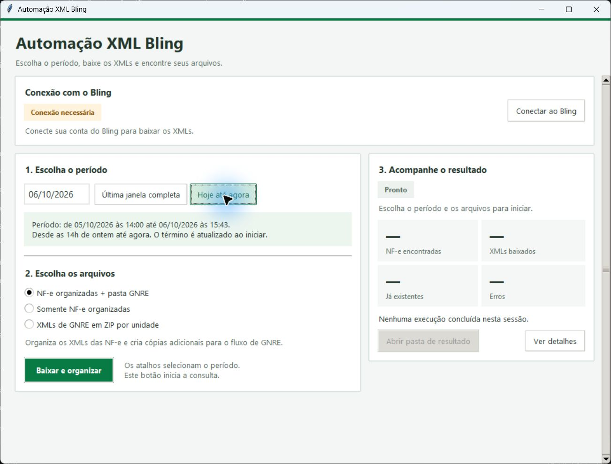
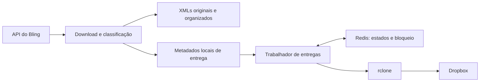

# Automação de XML de NF-e do Bling

Automação em Python para consultar NF-e no Bling, preservar e organizar os XMLs autorizados e entregar os documentos ao Dropbox. A rotina pode funcionar em uma máquina Windows dedicada ou em um servidor Debian com Docker Compose, rclone e Redis.

O projeto nasceu de uma necessidade operacional diária e é utilizado em produção. Este README apresenta a arquitetura e os procedimentos reutilizáveis; configurações reais, credenciais, documentos fiscais e detalhes da infraestrutura ficam fora da documentação pública.

- **Coleta e organização:** consulta por janela de emissão, cópia original e classificação por unidade, marketplace, data e UF.
- **Execução automática:** agendamento diário e recuperação das janelas pendentes após interrupções.
- **Entrega na nuvem:** trabalhador independente, envio por rclone e conferência do inventário remoto.
- **Controle persistente:** Redis mantém estados, tentativas, eventos e bloqueio entre execuções.
- **Uso manual:** aplicativo Windows com acompanhamento da consulta e geração de ZIPs para o fluxo de GNRE.

[Fluxo](#fluxo-da-automação) · [Integração com a nuvem](#integração-com-a-nuvem-rclone-e-redis) · [Instalação](#formas-de-instalação) · [Execução manual](#execução-manual) · [Acompanhamento](#logs-e-acompanhamento) · [Segurança](#segurança)



Interface da versão atualizada do executável, antes de iniciar uma consulta.

A execução diária ocorre às **14h10**, considerando a janela encerrada às **14h**, no fuso `America/Sao_Paulo`.

## Fluxo da automação

1. Consulta as NF-e emitidas na janela diária.
2. Mantém somente notas autorizadas ou com DANFE emitida.
3. Exclui notas canceladas antes do download.
4. Baixa o XML pela chave de acesso.
5. Preserva uma cópia original.
6. Classifica o documento por CNPJ emitente, marketplace, data e UF.
7. Quando a configuração Dropbox está presente, grava metadados locais para a entrega posterior.
8. Registra a janela concluída para recuperar dias pendentes após uma interrupção.
9. Com a integração habilitada, um trabalhador separado confere as pendências e envia os XMLs ao Dropbox.



O download e a entrega têm controles separados. Uma janela concluída indica que a coleta terminou com sucesso; as entregas continuam sendo acompanhadas individualmente no Redis. O trabalhador pode escoar pendências mesmo sem uma nova janela de download.

### Janela diária

Cada execução processa as últimas 24 horas fechadas às 14h:

```text
Dia anterior às 14:00  →  Dia atual às 14:00
```

O início é inclusivo e o final é exclusivo. Por exemplo, a janela identificada como `21-09-2026` contém emissões desde `20-09-2026 14:00:00` até antes de `21-09-2026 14:00:00`.

## Organização dos arquivos

```text
xml_por_cnpj/
└── Matriz ou Filial/
    └── Marketplace/
        ├── DD-MM-AAAA/
        │   └── UF/
        │       └── CHAVE_DA_NFE.xml
        └── GNRE/
            └── DD-MM-AAAA/
                └── UF/
                    └── CHAVE_DA_NFE.xml
```

Quando a UF de destino estiver configurada para a unidade emitente, o XML também recebe uma cópia na pasta `GNRE`. Essa cópia funciona como uma fila operacional e não substitui a classificação principal.

Os XMLs sem classificação também permanecem em:

```text
xml_originais/DD-MM-AAAA/
```

As unidades, os canais do Bling, os CNPJs dos intermediadores e as UFs que exigem GNRE são mapeados no arquivo local `configuracao.json`. Use [`configuracao.example.json`](configuracao.example.json) como modelo; a configuração real não deve ser enviada ao repositório.

## Integração com a nuvem: rclone e Redis

A integração implementada usa **Dropbox como destino**, **rclone para transportar os XMLs** e **Redis para persistir o controle de entregas**. No Debian, o Docker Compose coordena Redis, coleta e entrega; Python e rclone já fazem parte da imagem da automação.

### Da coleta à entrega

Quando existe `configuracao_dropbox.json`, o download grava um JSON por chave de NF-e em `dados/entregas/metadados/`. Esse registro contém a referência ao XML local, emitente, canal do Bling, situação, emissão e hash SHA-256. A gravação é atômica e os caminhos são relativos à pasta de dados, permitindo preservar as referências ao migrar a instalação.

O trabalhador cruza esses metadados com o histórico inicial de entregas, os estados do Redis e uma listagem atual do Dropbox. Somente notas nas situações **Emitida DANFE (5)** ou **Autorizada (6)**, dentro do corte de emissão e com rota conhecida podem ser selecionadas. O XML precisa conter a NF-e e seu protocolo de autorização compatível com a chave.

As rotas são definidas pela combinação **CNPJ emitente + ID do canal no Bling**. A estrutura remota é independente das pastas locais por data e UF. Exemplo fictício de destino:

```text
Filial_Ecommerce/Canal_Exemplo_1/CHAVE_DA_NFE-nfe.xml
```

### Papel do rclone

O rclone usa um `remote` autorizado, configurado em `segredos/rclone/rclone.conf`. O trabalhador lista os XMLs para identificar chaves já presentes e repete a consulta antes de cada envio. A conferência também reconhece arquivos na subpasta `XML Importados` da rota esperada. Uma chave encontrada em outra rota exige revisão.

Cada transferência usa `rclone copyto --immutable`, com um arquivo por vez e sem retentativas automáticas adicionais configuradas pelo projeto. Antes de iniciar, a aplicação confere o SHA-256 e congela uma cópia dos bytes validados. A integração não executa espelhamento, movimentação nem exclusão remota.

O sucesso do rclone confirma a transferência para o Dropbox. O processamento posterior do documento por outro sistema tem seu próprio fluxo e não é confirmado por esta automação.

### O que fica salvo no Redis

Os XMLs continuam no sistema de arquivos e no Dropbox. O Redis guarda o registro de cada entrega pela chave de acesso, incluindo destino, hash, emitente, canal, estado, tentativas, horários e evidências de conclusão. Também mantém um índice das notas e um stream de eventos das alterações de estado.

| Estado | Significado |
|---|---|
| `pendente` | Entrega cadastrada, aguardando seleção e validações |
| `em_envio` | Tentativa registrada antes de iniciar a transferência |
| `entregue` | Transferência concluída ou entrega preexistente reconhecida por evidência |
| `falha` | Falha registrada; uma nova tentativa depende das validações do ciclo |
| `incerto` | Envio sem confirmação ou interrompido; exige conciliação antes de repetir |
| `revisao` | Divergência de identidade, conteúdo ou destino; exige análise |

Um bloqueio com prazo de validade impede dois trabalhadores de processarem entregas simultaneamente. As alterações de registro, índice e evento usam transações Redis. O instante do próximo lote também é persistido, para que um reinício não elimine a espera configurada. O exemplo trabalha com **até cinco arquivos por lote**, com **60 segundos de intervalo**; o código limita cada lote a cinco.

Os registros das notas não expiram automaticamente. No Compose, o Redis usa o volume `redis-dados`, AOF com sincronização `everysec` e política `noeviction`, que impede o descarte automático de registros ao atingir o limite de memória, sem publicar a porta no host. Se o controle ficar indisponível ou inconsistente, novos envios são suspensos.

Essa persistência precisa de backup. AOF `everysec` admite a perda de gravações recentes em uma queda abrupta, e não existe transação única entre Redis e Dropbox. Por isso, um resultado incerto não é reenviado automaticamente: após uma interrupção, registros que ficaram em `em_envio` passam a `incerto` para conciliação. O objetivo é evitar duplicidades sem presumir que uma falha de conexão significa que o arquivo não chegou.

### Configuração e simulação

Use [`configuracao_dropbox.example.json`](configuracao_dropbox.example.json) como referência. Os CNPJs, canais e pastas desse arquivo são fictícios.

| Campo | Função |
|---|---|
| `habilitada` e `modo` | Mantêm o envio bloqueado com `false` e `simulacao`; o envio real exige `true` e `envio` |
| `inicio_emissao` | Corte mínimo de emissão, com fuso; deve ser escolhido para cada instalação |
| `rotas` | Mapeamento de emitente e canal para a pasta remota |
| `remote` e `rclone_config` | Remote autorizado e caminho da configuração do rclone |
| `redis_url` e `redis_prefixo` | Conexão e prefixo dos registros de entrega |
| `max_por_lote` e `intervalo_lotes_segundos` | Limite de arquivos e espera entre lotes |
| `historico_inicial` | Arquivo das entregas já conferidas, relativo à pasta de dados |

O corte `inicio_emissao` filtra as entregas. A primeira janela de download é escolhida separadamente por `AUTOMACAO_PRIMEIRA_DATA` ou pelo instalador.

Antes de habilitar envios, confira o histórico inicial, as rotas e a cobertura dos metadados. O histórico deve existir mesmo quando não há entregas anteriores; nesse caso, seu conteúdo pode ser `{"notas": []}`. Ele registra entregas conhecidas, sem substituir a consulta atual ao Dropbox.

Com Redis iniciado e a imagem preparada, execute na raiz da instalação:

```bash
docker compose run --rm --no-deps entregas-dropbox python integracao_dropbox.py simular --saida /dados/logs/simulacao_dropbox.json
```

O comando lê os arquivos locais, o Redis e o inventário remoto, e salva um relatório com decisões e lotes. Não envia XMLs nem altera registros Redis, mesmo que a configuração esteja em modo de envio. Sem metadados locais, o relatório pode ficar vazio; isso não valida a cobertura das notas. As consultas ao Dropbox podem renovar a autorização do rclone, por isso seu diretório de configuração precisa permitir escrita.

## Formas de instalação

Use apenas **uma** forma de execução por vez. Duas instalações ativas podem tentar renovar os mesmos tokens e processar a mesma janela simultaneamente.

### Windows

Indicada para um computador Windows dedicado.

1. Baixe ou clone o repositório em uma pasta fixa.
2. Copie `configuracao.example.json` para `configuracao.json` e preencha os dados reais.
3. Adicione `.env` e `tokens.json` na raiz do projeto.
4. Abra `Instalar automacao.cmd`.
5. Escolha a última janela encerrada ou informe a primeira data a recuperar.
6. Confira a tarefa `Automacao XML Bling - Diario` no Agendador de Tarefas.

O instalador:

- localiza ou instala o Python;
- instala as dependências;
- permite escolher a primeira janela, sem marcar notas como processadas;
- testa a conexão e a permissão de consulta de NF-e no Bling;
- valida o executor em modo de simulação;
- cria a execução diária para as 14h10;
- configura novas tentativas em caso de falha.

A tela pode permanecer bloqueada, mas o usuário configurado para a tarefa precisa continuar conectado.

A conexão de teste não baixa XMLs e pode renovar os tokens. Se ela falhar, o
instalador não cria nem altera a tarefa. Use o fuso de Brasília no Windows.
Para validar sem criar tarefa ou salvar a escolha, execute
`powershell -NoProfile -ExecutionPolicy Bypass -File instalar_automacao.ps1 -ValidarSomente`.
Para instalar sem perguntas, use `-PrimeiraData AAAA-MM-DD` ou `-UltimaJanela`.

### Debian com Docker Compose

O Debian hospeda os contêineres e preserva dados e credenciais em diretórios locais. Não é necessário instalar Python, Redis ou rclone separadamente no host para a rotina principal.

Requisitos:

- Docker Engine e Docker Compose;
- arquitetura `amd64`;
- fuso `America/Sao_Paulo`;
- acesso à internet para Bling, Dropbox e preparação das imagens.

O Compose também pode ser utilizado com Docker Desktop em uma máquina compatível.

| Serviço | Perfil | Responsabilidade |
|---|---|---|
| `redis` | Sem perfil | Persiste o controle das entregas; inicia sem ativar a rotina |
| `automacao-xml-bling` | `download` | Recupera janelas pendentes e agenda a coleta diária |
| `entregas-dropbox` | `entrega` | Verifica e processa entregas independentemente do download |

#### Preparação no Debian

Em uma instalação nova:

1. Copie `configuracao.example.json` para `configuracao.json` e preencha unidades e canais.
2. Copie `configuracao_dropbox.example.json` para `configuracao_dropbox.json`; ajuste corte e rotas, mantendo `habilitada=false` e `modo=simulacao`.
3. Transfira por um meio seguro as credenciais atuais para `.env`, `segredos/tokens.json` e `segredos/rclone/rclone.conf`.
4. Forneça o histórico conferido em `dados/entregas/ja_entregues.json` ou `bootstrap/ja_entregues.json`.
5. Execute o instalador na raiz do projeto:

```bash
bash scripts/instalar_integracao_debian.sh
```

O script confere Docker e arquitetura, restringe permissões dos segredos, constrói a imagem, inicia somente Redis e executa a simulação. O relatório fica em `dados/logs/simulacao_instalacao.json`. Ele preserva arquivos existentes e interrompe a preparação se os serviços de download ou entrega já estiverem ativos. O rclone é incluído na imagem com checksum SHA-256 verificado.

Os perfis `download` e `entrega` ficam parados nessa etapa. A simulação consulta o histórico inicial, mas não o importa para Redis nem registra entregas reais.

#### Iniciar a rotina

Na primeira instalação, a opção padrão começa pela última janela encerrada.
Para recuperar desde outra data, acrescente `AUTOMACAO_PRIMEIRA_DATA=AAAA-MM-DD`
ao `.env`, usando uma janela já encerrada. Em seguida:

```bash
docker compose --profile download up -d --build
```

Confira o serviço:

```bash
docker compose logs -f automacao-xml-bling
```

O contêiner inicia junto com o Docker, verifica dias pendentes e agenda as próximas execuções para as 14h10 no fuso `America/Sao_Paulo`.

Para ativar também as entregas, confira primeiro a simulação, o histórico e as rotas. Então defina `habilitada=true` e `modo=envio` na configuração local e inicie o serviço:

```bash
docker compose --profile entrega up -d entregas-dropbox
```

Iniciar o serviço com a configuração de exemplo mantém os uploads bloqueados. Sem perfis, `docker compose up -d` inicia somente Redis.

Antes de iniciar downloads e agendamento, o contêiner valida a configuração e o
acesso às NF-e no Bling. Se houver falha, ele termina sem avançar o estado; a
política de reinício do Docker pode tentar novamente. A primeira janela escolhida
fica em `dados/configuracao_execucao.json`; reinícios preservam essa escolha e o
histórico, mesmo que a variável `AUTOMACAO_PRIMEIRA_DATA` seja alterada depois.

Comandos úteis:

```bash
# Ver as janelas pendentes sem baixar ou alterar o estado
docker compose exec automacao-xml-bling python executar_diario.py --simular

# Reiniciar os serviços existentes
docker compose restart

# Parar preservando o volume Redis e os dados locais
docker compose down
```

Ao atualizar ou migrar, preserve `dados/`, `segredos/`, as configurações locais e o volume `redis-dados`. `docker compose down -v` remove os volumes e não deve ser usado quando houver histórico a preservar. A pasta do rclone e o arquivo de tokens precisam permitir a persistência das renovações de autorização.

### Certificado e consulta GNRE no Debian

Para ensaiar a instalação do certificado GNRE no Debian, execute
`python3 scripts/instalar_certificado_gnre.py --ensaio` no terminal. O script
requer OpenSSL 3 e procura um PFX fictício em uma pasta Downloads temporária.
A senha do PFX fictício é `gnre-teste-123`. As perguntas são as mesmas da
instalação real, e a última linha identifica o ensaio.
O modo `--instalar` procura arquivos PFX ou P12 em `~/Downloads` e nas
subpastas. Pressione Enter se houver apenas um ou selecione pelo número da
lista se houver vários. O instalador pede a senha no terminal e grava a
identidade em `~/.local/share/automacao-xml-bling/gnre/identidade.pem`.
Execute como o usuário da automação, sem `sudo`. A chave PEM fica sem senha e
o acesso é restrito pelas permissões no Debian.

Depois da instalação, execute `bash scripts/testar_gnre_debian.sh` como o mesmo
usuário. O Compose separado `docker-compose.gnre.yml` usa a imagem já instalada
`automacao-xml-bling:2.0-dropbox` e monta a pasta do certificado somente no serviço
`gnre`, em modo de leitura. O contêiner usa o UID e o GID do usuário no Debian.
O teste consulta `GnreConfigUF` em produção, para MS e receita 100102.
Use `--ambiente homologacao`, `--uf AL` ou `--receita 100129` para mudar a
consulta, ou `--somente-certificado` para conferir somente a leitura da credencial.
O cliente obtém o contrato SOAP 1.2 pelo WSDL oficial e verifica o retorno 450.
A emissão das guias continua sendo uma etapa futura da integração.

## Configuração do Bling

Crie um arquivo `.env` na raiz com as credenciais do aplicativo, sem colocar valores reais no repositório:

```dotenv
BLING_CLIENT_ID=seu_client_id
BLING_CLIENT_SECRET=seu_client_secret
BLING_REDIRECT_URI=http://localhost:8000/callback
```

A URI precisa ser a mesma cadastrada no aplicativo do Bling. Para realizar a autorização OAuth inicial em uma máquina com navegador:

```bash
python autenticar_bling.py
```

O comando cria `tokens.json`. Transfira esse arquivo somente por um meio seguro para a máquina de execução. O programa renova o token automaticamente quando necessário.

> `.env` e `tokens.json` contêm credenciais. Ambos estão protegidos pelo `.gitignore` e nunca devem ser enviados ao GitHub.

## Execução manual

Instale as dependências:

```bash
python -m pip install -r requirements.txt
```

Baixe uma janela específica das 14h:

```bash
python baixar_xmls.py 2026-09-21 --janela-14h
```

Para consultar desde as 14h de ontem até o horário atual, use a data de hoje:

```bash
python baixar_xmls.py --janela-14h --ate-agora
```

Execute o controle diário e a recuperação de pendências:

```bash
python executar_diario.py
```

Veja o que seria processado sem baixar arquivos:

```bash
python executar_diario.py --simular
```

Na primeira execução, processe um histórico a partir de uma data determinada:

```bash
python executar_diario.py --primeira-data 2026-09-01
```

`--primeira-data` só é aceito antes da criação de `estado_execucao.json`.

A instalação salva a primeira janela em `configuracao_execucao.json`, separado
do histórico de sucesso. O executor usa essa data até concluir a primeira janela;
depois continua a partir de `estado_execucao.json`. Uma reinstalação preserva o
progresso e não reinicia a recuperação de dias já concluídos.

Para conferir entregas omitidas de uma janela já baixada, com Redis ativo na
instalação Docker:

```bash
docker compose run --rm --no-deps entregas-dropbox python recuperar_entregas_pendentes.py AAAA-MM-DD
```

Substitua `AAAA-MM-DD` pela janela a conferir. O comando consulta os metadados no
Bling e valida os XMLs locais. Sem `--aplicar`, apresenta somente o plano; com
essa opção, registra as pendências para o trabalhador de entregas.

## Pacote da automação diária

Gere o ZIP atualizado para entrega com:

```powershell
py -3.14 empacotar_automacao.py
```

O arquivo `Pacote-Automacao-XML-Bling.zip` contém o código atual, a configuração
local de unidades e marketplaces, instaladores Windows/Docker, dependências offline
e instruções. Requer `python-3.14.7-amd64.exe` na raiz, com SHA256 válido.
O pacote usa uma lista explícita de arquivos: não inclui `.env`, `tokens.json`,
XMLs, logs, histórico nem escolha de data da máquina de origem. O `manifesto.json`
registra os hashes dos arquivos entregues para conferir a integridade.

No pacote, o TI coloca `.env` e `tokens.json` em `arquivos-automacao` antes de
instalar e escolhe uma das pastas `instalacao-windows` ou `instalacao-docker`.
As instruções específicas acompanham cada pasta. Ao migrar uma instalação,
transfira também a pasta `dados` da máquina anterior e mantenha apenas uma ativa.

## Aplicativo com interface

O arquivo `app_desktop.py` oferece uma interface para uso manual no Windows. Nela é
possível conectar o computador ao Bling, selecionar a data da janela e escolher entre:

- NF-e organizadas sem cópias na pasta GNRE;
- NF-e organizadas com as cópias adicionais na pasta GNRE.
- somente as GNRE em arquivos ZIP separados por unidade.

Clique em **Hoje até agora** para consultar desde as **14h de ontem até o horário
em que a consulta é iniciada**. A data fica fixada em hoje nesse modo. Às 13h,
o período termina às 13h; às 16h, termina às 16h, incluindo as emissões posteriores
às 14h. O atalho selecionado recebe destaque em verde.
Use **Última janela completa** para voltar à consulta de janelas já encerradas
às 14h ou para escolher outra data.

Os atalhos **Última janela completa** e **Hoje até agora** preenchem a data e
ajustam o modo de consulta automaticamente. Abaixo das opções de data, a
interface mostra o início e o término do período que será consultado. Em uma
consulta parcial, o término mostrado é uma prévia que se atualiza até o início
da execução; o download considera o horário em que a consulta começa.

Ao concluir, o painel **Acompanhamento** mantém na tela a data da última janela,
as quantidades de NF-e encontradas, XMLs baixados, arquivos já existentes e erros.
O resumo inclui avisos de notas sem chave de acesso e informações sobre os ZIPs
de GNRE, quando houver. Ele permanece disponível durante outras consultas na
mesma sessão; ao fechar o aplicativo, os registros continuam nos arquivos de log.
Use **Ver detalhes** para expandir os logs na tela e **Abrir pasta de resultado**
para acessar os arquivos. Em janelas menores, a barra de rolagem permite acessar
todo o conteúdo.

Em janelas largas, as opções e o resumo ficam lado a lado; em janelas menores,
o resumo aparece abaixo das opções. Cada modo de saída traz uma explicação, e
o botão principal muda para **Baixar e gerar ZIPs** no modo de ZIP. A barra de
progresso aparece durante a execução, com estados visuais para andamento,
sucesso, avisos e falhas. As opções ficam bloqueadas enquanto há trabalho em
andamento. O botão de abrir resultado só fica disponível quando a pasta existe.

O estado **Autorização salva** indica que o arquivo de autorização está presente
neste computador. A conexão com o Bling é verificada ao iniciar uma consulta.

No modo de ZIP, os arquivos são criados em `Documentos\Automacao XML
Bling\GNRE - ZIP`, com nomes como `Matriz DD-MM-AAAA.zip` e `Filial
DD-MM-AAAA.zip`. Dentro de cada ZIP, os XMLs ficam separados por marketplace e
UF. Esse modo não cria a cópia principal das NF-e na estrutura organizada; os
XMLs originais continuam preservados.

Para testar a interface pelo código-fonte:

```powershell
py -3.14 app_desktop.py
```

Para gerar o executável, instale o PyInstaller e execute o script de compilação:

```powershell
py -3.14 -m pip install pyinstaller
.\compilar_aplicativo.ps1
```

O pacote é criado em `dist/Entrega-Automacao-XML-Bling`. Por segurança, ele nunca
inclui `tokens.json`. No computador de destino, coloque `.env` e
`configuracao.json` ao lado do executável e use o botão **Conectar ao Bling** na
primeira abertura. A opção `-IncluirConfiguracaoLocal` copia os dois arquivos de
configuração para a entrega, mas deve ser usada somente quando o pacote for enviado
por um meio seguro.

No executável, os tokens ficam em `%LOCALAPPDATA%\Automacao XML Bling` e os XMLs,
logs e resultados ficam em `Documentos\Automacao XML Bling`.

## Logs e acompanhamento

Na instalação Docker, os principais arquivos ficam em `dados/`:

| Arquivo | Conteúdo |
|---|---|
| `logs/executor_diario.log` | Inicialização, pendências, sucessos e falhas do executor |
| `logs/automacao_AAAA-MM-DD_14h.log` | Resultado detalhado de cada janela |
| `estado_execucao.json` | Última janela concluída e data da atualização |
| `configuracao_execucao.json` | Primeira janela escolhida na instalação |
| `entregas/metadados/` | Referência ao XML, emitente, canal e hash de cada NF-e |
| `entregas/ja_entregues.json` | Histórico inicial conferido, usado na conciliação |
| `logs/simulacao_instalacao.json` | Plano produzido durante a preparação Debian |

O controle das entregas fica no volume Redis, separado desses arquivos. Em uma instalação organizada para Windows, os arquivos da rotina diária também podem ficar na pasta compartilhada `dados/`.

O estado só avança depois que uma janela termina com sucesso. Se a máquina ficar desligada, a próxima execução processa as janelas pendentes em ordem e interrompe no primeiro erro.

Para acompanhar os serviços e consultar os estados das entregas:

```bash
docker compose ps
docker compose logs --tail=100 entregas-dropbox
docker compose run --rm --no-deps entregas-dropbox python integracao_dropbox.py status
```

O comando `status` faz somente leitura do Redis e apresenta um resumo por estado, seguido dos registros das notas. Sua saída contém metadados fiscais e deve ser tratada como informação privada.

Os utilitários de diagnóstico ficam em `scripts/`. No Debian, execute
`bash scripts/diagnostico_debian.sh` para consultar o sistema. Para conferir
entregas com o serviço `entregas-dropbox` ativo, execute na raiz da instalação:

```bash
docker compose exec -T entregas-dropbox python - < scripts/diagnosticar_entregas_debian.py
```

Os dois diagnósticos fazem somente consultas, sem enviar arquivos nem alterar
configurações ou registros no Redis. Use `sudo` nos comandos Docker se a conta
não tiver acesso direto.

## Testes

Execute os testes automatizados com:

```bash
python -m unittest discover -p "test_*.py" -v
```

Os testes da integração cobrem planejamento, bloqueio de uploads na simulação, conferência de XML e hash, concorrência, intervalo entre lotes e retomada de envios incertos. Os cenários Redis usam `fakeredis`, dependência de desenvolvimento opcional; instale-a com `python -m pip install fakeredis` para executar também esses testes, que são ignorados quando ela está ausente. Não é necessário acessar um Dropbox real para esses cenários.

## Principais arquivos

| Arquivo | Função |
|---|---|
| `baixar_xmls.py` | Consulta as notas, filtra as situações e baixa os XMLs |
| `organizar_xmls.py` | Classifica os XMLs na estrutura de pastas |
| `executar_diario.py` | Controla estado, pendências e execução exclusiva |
| `agendador_docker.py` | Agenda e repete execuções dentro do contêiner |
| `integracao_dropbox.py` | Grava metadados, planeja entregas e executa o trabalhador |
| `registro_entregas.py` | Persiste estados e eventos, controla bloqueio e intervalo no Redis |
| `transporte_dropbox.py` | Lista XMLs remotos e transfere arquivos validados pelo rclone |
| `instalar_rclone.py` | Prepara o binário rclone com verificação de integridade |
| `docker-compose.yml` | Coordena Redis, download e entrega em serviços separados |
| `preparar_instalacao.py` | Escolhe a primeira janela e valida o acesso ao Bling |
| `empacotar_automacao.py` | Gera o pacote diário atualizado sem credenciais ou histórico |
| `empacotar_debian.py` | Gera o pacote Debian em simulação com instruções genéricas |
| `recuperar_entregas_pendentes.py` | Confere XMLs locais e recupera metadados de entregas omitidas |
| `scripts/` | Instalador Debian e diagnósticos reutilizáveis |
| `bling_auth.py` | Carrega e renova os tokens OAuth |
| `autenticar_bling.py` | Realiza a autorização OAuth inicial |
| `configuracao.example.json` | Modelo anonimizado da configuração de unidades, canais e intermediadores |
| `configuracao_dropbox.example.json` | Modelo fictício de rotas, corte, conexão e limites de entrega |

## Segurança

- Mantenha exemplos públicos fictícios, sem CNPJs reais, nomes internos, endereços de servidores ou caminhos da operação.
- Não envie `.env`, `tokens.json`, `rclone.conf`, certificados ou configurações reais ao repositório.
- XMLs, metadados, históricos, logs e relatórios podem conter dados fiscais e operacionais; mantenha-os privados, inclusive ao compartilhar diagnósticos.
- Mantenha somente uma instalação ativa.
- Restrinja o acesso às pastas de dados e segredos na máquina de execução.
- Preserve backups dos dados e do Redis; imagens Docker e pacotes de código não substituem o histórico de entregas.
- Os pacotes gerados podem conter configuração local e, no pacote Debian, histórico inicial de NF-e. Revise seu conteúdo e use um meio de distribuição privado.
